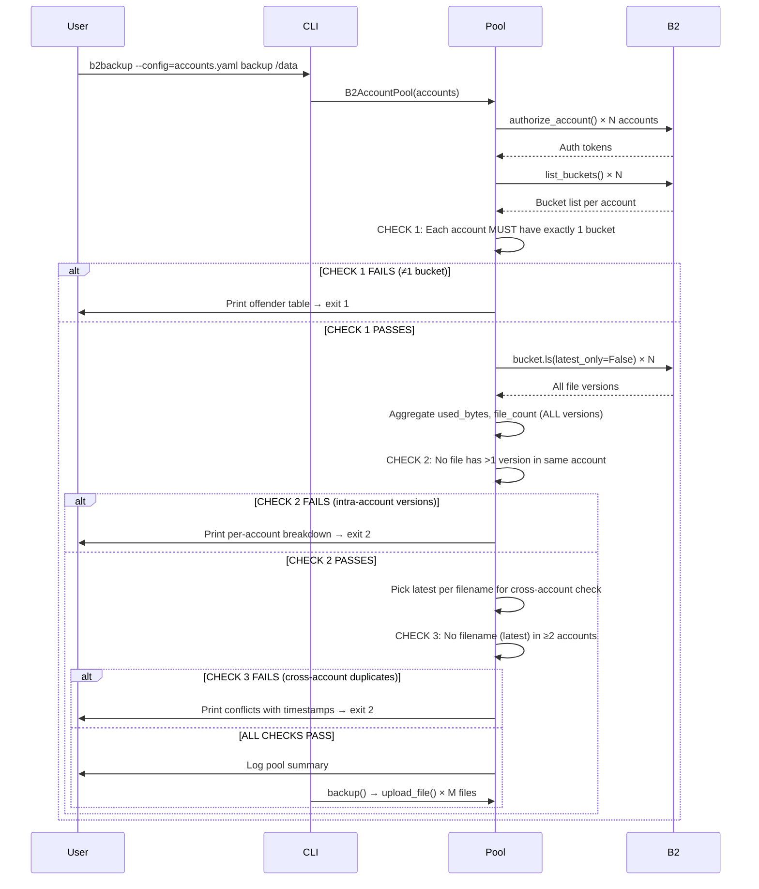

# b2backup

A minimal, single-process CLI tool for backing up directories to a pool of Backblaze B2 accounts. Designed for personal use on trusted networks.

## Design Philosophy

| Principle | Decision |
|-----------|----------|
| **Simplicity over features** | ~450 LOC total; no daemon, no HTTP, no job queue |
| **Trust the user** | No auth, no rate limits, no CSRF, no CSP |
| **B2 as source of truth** | Startup scan validates consistency; cache updated on mutations |
| **Atomic upserts** | Replacements always go to a *different* account; old version deleted after |
| **Best-fit placement** | Pack files into accounts with least remaining space (bin-packing) |
| **Strict validation** | Hard stop on any inconsistency (bucket count, versions, duplicates) |
| **Observable** | Structured logging; `stats` command shows capacity per account |

---

## Constraints & Assumptions

### Backblaze B2 Constraints
- **1700 files per bucket** (hard limit for `list_files` / `ls`)
- **Per-application-key bucket access**: Each key must list exactly one bucket
- **No native multi-bucket per key**: Workaround = multiple keys/accounts
- **All versions count against limits**: Hidden versions consume file slots and bytes
- **Eventual consistency**: `list_buckets` / `ls` may lag seconds after mutations

### Operational Constraints
- **Single writer**: No locking; assume one `b2backup` process at a time
- **No external mutations**: Cache assumes no other writers (other tools, manual B2 UI)
- **Trusted network**: No TLS, no auth — deploy behind VPN/SSH tunnel if remote
- **Memory-bound cache**: Entire file index in RAM (≈ 200 bytes/file → 2M files ≈ 400MB)

### Not Supported (by design)
- Resumable uploads (re-upload on failure)
- Parallel uploads (single-threaded, sequential)
- Encryption at rest (use B2 SSE or encrypt client-side before backup)
- Deduplication (content-addressable; we use path-based names)
- Snapshots / versioning (B2 keeps hidden versions; we only track latest)

---

## Project Structure

```
b2backup/
├── pyproject.toml          # Package metadata, deps, entry point
├── README.md               # This file
├── accounts.yaml.example   # Template config
└── b2backup/
    ├── __init__.py         # Version
    ├── config.py           # YAML loading → Account dataclasses
    ├── storage.py          # B2AccountPool: cache, routing, mutations
    └── cli.py              # Click commands: backup, restore, delete, ls, stats
```

### Module Responsibilities

| Module | Responsibility | Key Classes/Functions |
|--------|----------------|----------------------|
| `config.py` | Parse `accounts.yaml` | `Account`, `load_config()` |
| `storage.py` | All B2 logic, cache, routing | `B2AccountPool`, `AccountState`, `BucketValidationError`, `ConsistencyError` |
| `cli.py` | CLI UX, progress bars, output | `backup`, `restore`, `delete`, `ls`, `stats` |

---

## Architecture Overview

```
┌─────────────────────────────────────────────────────────────────┐
│                        b2backup CLI                              │
├─────────────────────────────────────────────────────────────────┤
│  Click command parser                                            │
│  ├─ backup   → walk dir → upload_file() for each                │
│  ├─ restore  → download_file()                                  │
│  ├─ delete   → delete_file()                                    │
│  ├─ ls       → list_files() (from cache)                        │
│  └─ stats    → get_pool_stats() (from cache + live check)       │
└────────────────────────────────┬────────────────────────────────┘
                                 │
                                 ▼
┌─────────────────────────────────────────────────────────────────┐
│                      B2AccountPool                               │
├─────────────────────────────────────────────────────────────────┤
│  Startup (strict validation - HARD STOP on any inconsistency):  │
│  1. Authorize each account_id/account_key                       │
│  2. list_buckets() → MUST return exactly 1 bucket per account   │
│     → If ANY account has ≠1 bucket: print offenders → exit 1    │
│  3. For each bucket: ls(latest_only=False) — scan ALL versions  │
│     - Sum used_bytes, file_count (ALL versions count)           │
│     - If ANY file has >1 version in SAME account:               │
│       print per-account breakdown → exit 2                      │
│     - Pick latest version per filename for cross-account check  │
│  4. Cross-account duplicate check on latest versions            │
│     → If SAME filename (latest) in ≥2 accounts:                 │
│       print conflicts with timestamps → exit 2                  │
│  5. If ALL checks pass: log pool summary → proceed              │
│                                                                  │
│  Runtime:                                                        │
│  - _pick_account(size, exclude) → best-fit eligible account     │
│  - upload_file() → new: pick any; replace: pick ≠ source        │
│  - Cache updated on every mutation                              │
└────────────────────────────────┬────────────────────────────────┘
                                 │
                    ┌────────────┼────────────┐
                    ▼            ▼            ▼
              ┌─────────┐  ┌─────────┐  ┌─────────┐
              │Account 1│  │Account 2│  │Account N│
              │(bucket) │  │(bucket) │  │(bucket) │
              └─────────┘  └─────────┘  └─────────┘
```

---

## Data Model

### `Account` (from config)
```python
@dataclass
class Account:
    account_id: str          # B2 keyID (e.g., "ce6c123a9349")
    account_key: str         # B2 applicationKey
    capacity_in_mb: int | None  # Soft limit; None = unlimited
```

### `AccountState` (runtime, per account)
```python
@dataclass
class AccountState:
    account: Account
    bucket_name: str
    bucket: Bucket           # b2sdk Bucket handle
    used_bytes: int = 0      # Sum of ALL version sizes (for capacity)
    file_count: int = 0      # Count of ALL versions (for 1700 limit)
```

### Cache
```python
# In B2AccountPool:
_cache: dict[str, AccountState]   # filename (latest) → owning AccountState
_states: list[AccountState]       # All valid accounts
```

**Invariant**: `name in _cache` ⟺ file's LATEST version exists in exactly one account.

---

## Command Logic Flows

### 1. `b2backup backup /path/to/dir`

```mermaid
flowchart TD
    A[Resolve source path] --> B[root_name = source.name]
    B --> C[Walk source.rglob('*')]
    C --> D[Filter is_file()]
    D --> E{Any files?}
    E -->|No| F[Print "No files"; exit 0]
    E -->|Yes| G[For each file with tqdm]
    G --> H[rel = file.relative_to(source.parent)]
    H --> I[pool.upload_file(str(rel), file)]
    I --> J[Next file]
    J --> G
    G --> K[Print "Backup complete"]
```

**`pool.upload_file(name, local_path)`**:
```
upload_file(name, path)
    │
    ├─ file_size = path.stat().st_size
    ├─ existing = _cache.get(name)
    │
    ├─ if existing is None:                    # NEW FILE
    │     state = _pick_account(file_size)     # best-fit
    │     state.bucket.upload_bytes(data, name)
    │     state.used_bytes += file_size
    │     state.file_count += 1
    │     _cache[name] = state
    │
    └─ else:                                   # REPLACEMENT
          state = _pick_account(file_size, exclude=existing)
          state.bucket.upload_bytes(data, name)
          state.used_bytes += file_size
          state.file_count += 1
          _cache[name] = state
          try:
              old = existing.bucket.get_file_info_by_name(name)
              existing.bucket.delete_file_version(old.id_, name)
              existing.used_bytes -= old.size
              existing.file_count -= 1
          except: log warning (duplicate remains)
```

**`_pick_account(size, exclude)`**:
```
_eligible_accounts(size, exclude)
    For each state in _states (skip exclude):
        rem_bytes = capacity - used_bytes (if capacity set)
        rem_files = 1700 - file_count
        if rem_bytes >= size and rem_files > 0:
            add to eligible
    return eligible

Pick argmin(remaining_after) where remaining_after = rem_bytes - size
Tie-break: account_id (deterministic)
```

---

### 2. `b2backup restore "EFG/HIJ/file.ext" ./dest/`

```mermaid
flowchart TD
    A[pool.download_file(name, dest_path)] --> B[_cache.get(name)]
    B --> C{Found?}
    C -->|No| D[Raise FileNotFoundError]
    C -->|Yes| E[state.bucket.get_file_info_by_name(name)]
    E --> F[state.bucket.download_file_by_id(file_id)]
    F --> G[dest_path.write_bytes(content)]
    G --> H[Done]
```

---

### 3. `b2backup delete "EFG/HIJ/file.ext"`

```mermaid
flowchart TD
    A[pool.delete_file(name)] --> B[_cache.get(name)]
    B --> C{Found?}
    C -->|No| D[Raise FileNotFoundError]
    C -->|Yes| E[state.bucket.get_file_info_by_name(name)]
    E --> F[state.bucket.delete_file_version(file_id, name)]
    F --> G[state.used_bytes -= file.size]
    G --> H[state.file_count -= 1]
    H --> I[del _cache[name]]
    I --> J[Done]
```

---

### 4. `b2backup ls`

```mermaid
flowchart TD
    A[pool.list_files()] --> B[For each name, state in sorted(_cache)]
    B --> C[file_obj = state.bucket.get_file_info_by_name(name)]
    C --> D[Collect: name, size, timestamp, content_type, account_id]
    D --> E[Return list[dict]]
    E --> F[CLI prints formatted table]
```

> **Note**: `list_files()` does a live `get_file_info_by_name` per file to get fresh metadata. For large pools, consider caching metadata at startup (trade memory for speed).

---

### 5. `b2backup stats`

```mermaid
flowchart TD
    A[pool.get_pool_stats()] --> B[Aggregate totals from _states]
    B --> C[For each state: compute remaining_bytes, remaining_files]
    C --> D[Return dict with totals + per-account breakdown]
    D --> E[CLI prints formatted table]
```

---

## Startup Sequence (Critical Path)



---

## Routing Algorithm (Best-Fit)

```
Goal: Pack files tightly, leave large contiguous gaps for future large files.

For each account with capacity_in_mb set:
    remaining_bytes = capacity_mb * 1024^2 - used_bytes (ALL versions)
For unlimited accounts:
    remaining_bytes = ∞ (sorted last)

remaining_files = 1700 - file_count (ALL versions count)

Eligible iff:
    remaining_bytes >= file_size (or unlimited)
    remaining_files > 0
    account != exclude (for replacements)

Pick account minimizing: remaining_after = remaining_bytes - file_size
Tie-break: account_id (lexicographic, deterministic)
```

**Why best-fit?** Analogous to bin-packing. Worst-fit leaves fragmented small gaps; first-fit creates hot spots. Best-fit maximizes chance large future files fit.

---

## Consistency Guarantees

| Scenario | Guarantee |
|----------|-----------|
| **Startup: bucket count** | Hard stop if any account has ≠1 bucket; prints offender table |
| **Startup: intra-account versions** | Hard stop if any file has >1 version in same account; prints breakdown |
| **Startup: cross-account duplicates** | Hard stop if same filename (latest) in ≥2 accounts; prints conflict |
| **New file** | Written to exactly one account; cache updated atomically in-process |
| **Replace file** | New version written to *different* account; old deleted after; cache points to new |
| **Delete** | Removed from owning account; cache entry removed |
| **Crash mid-upload** | Partial upload leaves no cache entry; B2 may have orphan object |
| **Crash mid-replace** | New version in account B, old in account A → duplicate at next startup (caught) |

**Recovery**: If startup fails, manually resolve in B2 console:
- Bucket count: Restrict key to exactly one bucket
- Multiple versions: Delete old versions via B2 console/CLI
- Cross-account duplicates: Delete from all but one account

---

## Configuration

### `accounts.yaml` (compatible with b2router format)
```yaml
max_files_per_account: 1700    # Optional; informational only

accounts:
  - account_id: "ce6c123a9349"
    account_key: "005df4727d45a2ff206e29a7882b5e123e6f9954a7"
    capacity_in_mb: 10240      # Optional soft limit
  - account_id: "c5af2a9f177f"
    account_key: "00514c7bfc281fdfd9a75b2022ab08f043abeccfea"
    # capacity_in_mb omitted = unlimited
```

### Field Reference

| Field | Required | Description |
|-------|----------|-------------|
| `account_id` | Yes | B2 KeyID (12-char hex) |
| `account_key` | Yes | B2 Application Key (starts with `005`) |
| `capacity_in_mb` | No | Soft budget; `None` = unlimited |
| `max_files_per_account` | No | Global default (1700); informational |

---

## Installation & Usage

```bash
# Clone and install
git clone <this-repo> b2backup
cd b2backup
pip install -e .

# Copy config template
cp accounts.yaml.example accounts.yaml
# Edit with your B2 keys (chmod 600)

# Backup a directory
b2backup --config=accounts.yaml backup /home/user/photos

# List all backed up files
b2backup --config=accounts.yaml ls

# Show pool capacity
b2backup --config=accounts.yaml stats

# Restore a file
b2backup --config=accounts.yaml restore "photos/2024/IMG_123.jpg" ./restored/

# Delete a file
b2backup --config=accounts.yaml delete "photos/2024/IMG_123.jpg"
```

### Filename Convention

```
Source:     /home/user/photos/2024/IMG_123.jpg
Backup as:  photos/2024/IMG_123.jpg
            ^^^^^^
            root = last component of source path
```

---

## Logging

Uses Python `logging` with `INFO` default. Key events:

```
INFO: Pool ready: 47 accounts, 12847 unique files
INFO:   ce6c123a (backup-1): 283 files, 1024MB used, remaining: 9216MB, 1417 slots
INFO: Created photos/2024/IMG_123.jpg in backup-3 (2.4MB)
INFO: Replaced docs/report.pdf: backup-1 -> backup-7
WARNING: Replaced notes.txt but failed to delete old version: ...
INFO: Deleted old/backup.zip from backup-12
```

Set `B2BACKUP_LOG_LEVEL=DEBUG` for b2sdk HTTP traces.

---

## Testing

```bash
# Unit tests (fake B2 backend)
pytest b2backup/tests/

# Integration test (requires real B2 accounts)
B2BACKUP_TEST_CONFIG=accounts.yaml pytest b2backup/tests/integration/
```

Test coverage targets:
- Routing logic (best-fit, exclusion, capacity bounds)
- Cache consistency (duplicates, updates on mutate)
- CLI argument parsing and path handling
- Error paths (missing file, no space, no eligible account)
- Startup validation (bucket count, intra-versions, cross-duplicates)

---

## Operational Runbook

### Adding a New Account
1. Create B2 application key restricted to one new bucket
2. Add to `accounts.yaml`
3. Run `b2backup --config=accounts.yaml stats` → verify appears in pool

### Removing an Account
1. Run `b2backup --config=accounts.yaml stats` → note file count
2. If files exist: migrate by re-backing up those paths (they'll land elsewhere)
3. Remove from `accounts.yaml`
4. Run `stats` → verify removed

### Capacity Alerting
Monitor `stats` output:
- `remaining_files < 100` → add account or increase `capacity_in_mb`
- `remaining_mb < 1024` → add account or increase limit

### Disaster Recovery
| Failure | Recovery |
|---------|----------|
| Config lost | Recreate from B2: `list_buckets` → get keys → rebuild YAML |
| Cache corrupted | Delete nothing; restart rebuilds from B2 |
| Bucket count violation | Fix key restriction in B2 console; restart |
| Multiple versions | Delete old versions in B2 console/CLI; restart |
| Cross-account duplicates | Delete from all but one account; restart |
| Account key revoked | Remove from config; re-backup affected files |

---

## Comparison with b2router

| Feature | b2router | b2backup |
|---------|----------|----------|
| Interface | HTTP API + UI | CLI only |
| Concurrency | Multi-threaded, jobs | Single-threaded |
| Auth | Bearer token, sessions | None |
| Upserts | Async jobs, polling | Synchronous |
| Replacements | Atomic, rollback on failure | Best-effort delete old |
| Metrics | Prometheus `/metrics` | `stats` command |
| Reconciliation | Built-in CLI | Manual (B2 console) |
| Locking | `flock` single-writer | None (assume single user) |
| Code size | ~3000 LOC | ~450 LOC |

---

## Future Work (Non-Goals for v0.1)

- [ ] Parallel uploads (worker pool)
- [ ] Resumable multipart for >100MB files
- [ ] Client-side encryption (age/rage)
- [ ] Retention policies / snapshot management
- [ ] Config file discovery (`~/.config/b2backup/accounts.yaml`)
- [ ] Shell completions (`b2backup --install-completion`)

---

## License

MIT — see `LICENSE` file.